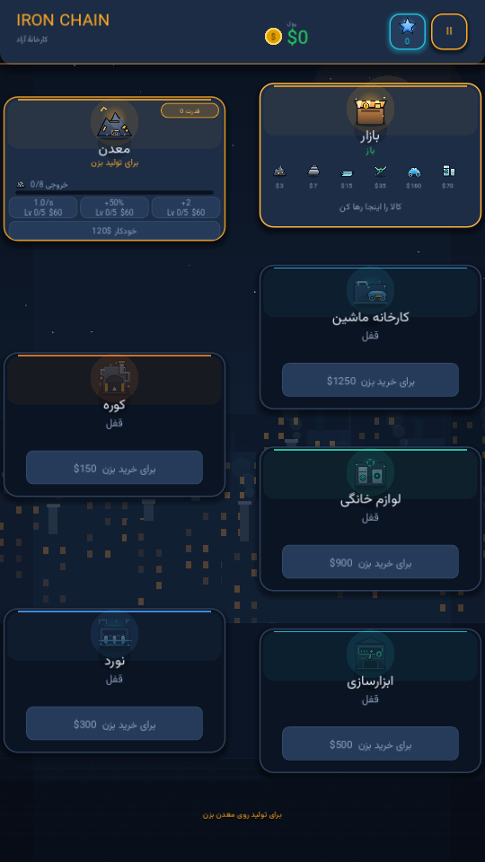
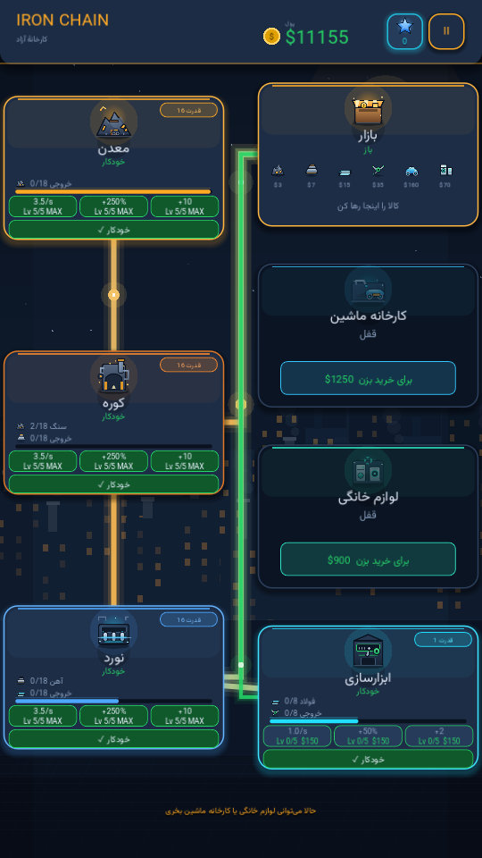
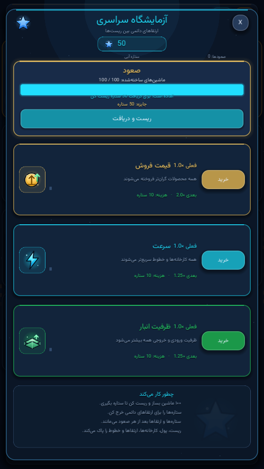
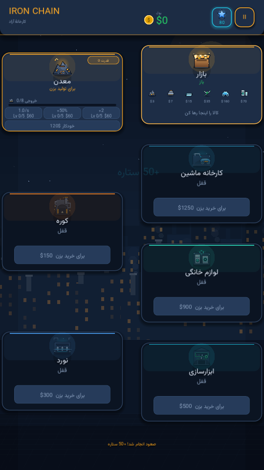

# Iron Chain — Factory Sandbox

A 2D industrial management sandbox built with **Godot 4.7.2** and **GDScript**.  
Build a steel production chain, connect factories with glowing lines, sell products, upgrade every building, and ascend through the **Global Lab** for permanent blue-star upgrades.

بازی مدیریتی/ساندباکس کارخانه‌ای با Godot 4.7.2 — ساخت زنجیرهٔ تولید فولاد، اتصال کارخانه‌ها، بازار، ارتقاهای شش‌سطحی و سیستم صعود (Ascension) با ستاره آبی.

## Screenshots

| Start | Production chain |
|---|---|
|  |  |

| Global Lab | After Ascension |
|---|---|
|  |  |

## Features

- Mine → Smelter → Mill → Tool Shop / Car Plant / Appliance Plant production chain
- Market with six sellable products and fixed base prices
- Drag-to-connect production lines with product colours, glow, moving items and gold strength colours
- Per-factory options: speed, sale price, storage and AUTO; three numeric tracks up to level 5
- Line throughput from 1 item/s up to 3.5 item/s through the source speed option (before global upgrades)
- **Global Lab** with three permanent tracks bought with **blue stars**: sale price, speed and storage
- **Ascension** at 100 built cars: reset the run, keep blue stars and global upgrades, earn 50 stars
- Persian (default) and English UI with Vazirmatn and RTL support
- Industrial night-city background, custom SVG art, animated cards and links
- Full-width top command bar (cash, blue stars, pause) and a compact staggered production layout
- Offline JSON save (format v5)

## Controls

| Action | Input |
|---|---|
| Produce one cycle | Tap/click a factory |
| Level an option | Tap/click ×1.5, +50% or +2 |
| Buy AUTO | Tap/click the AUTO row |
| Connect buildings | Drag from a factory to a target |
| Buy a factory | Tap/click a locked card |
| Cut a line | Tap/click the line |
| Pause | Top-right II, Esc or P |
| Restart from save | Pause menu or R |
| Open the Global Lab | Blue-star button in the top bar |
| Ascend / buy global upgrades | Buttons in the lab |

## Run

1. Install **Godot 4.7.2**.
2. Import `project.godot`.
3. Press **F5**.

## Build

### Windows

```text
Godot --headless --export-release "Windows Desktop" "build/windows/IronChain.exe"
```

The exported executable is written to `build/windows/IronChain.exe`.

### Android

The Android preset is configured for an **arm64-v8a debug APK**, target SDK 36, min SDK 24:

```text
Godot --headless --export-debug "Android APK" "build/android/IronChain-0.8.1-debug.apk"
```

Requirements:

- JDK 17
- Android SDK with build-tools 36.0.0, platform android-36 and platform-tools
- A debug keystore (alias `androiddebugkey`)

On this development machine the toolchain is under `D:\ghaffari\Android`:

- JDK: `D:\ghaffari\Android\jdk17`
- SDK: `D:\ghaffari\Android\Sdk`
- Debug keystore: `D:\ghaffari\Android\keystore\debug.keystore`
- Session setup: `D:\ghaffari\Android\android-env.bat`

To install on a USB-connected phone:

```bat
D:\ghaffari\Android\android-env.bat
adb install -r D:\ghaffari\jasb\build\android\IronChain-0.8.1-debug.apk
```

Build outputs are intentionally ignored by Git (`build/`). The source is the project.

## Save data

`user://save.json` → on Windows: `%APPDATA%\Godot\app_userdata\Iron Chain\save.json`

Format version 5 stores money, unlocked buildings, option levels, links, settings, blue stars, global upgrade levels, current-run cars built and ascension count. Older v4 saves start fresh.

## Project layout

```text
autoload/           Save manager, audio, scene router, game state
scenes/             Main, board, station and UI scenes
scripts/common/     Palette, bilingual text, SVG art mapping
scripts/economy/    Prices and global upgrade data
scripts/factory/    Station card, options, production
scripts/game/       Board, links, layout, tutorial, boot/window fit
scripts/ui/         HUD, Global Lab, menus, shared UI kit
resources/stations/ Per-building tuning (.tres)
assets/             Fonts, factory/resource/UI SVG art
docs/               GDD, changelog, release checklist, screenshots
```

## Version

**0.8.1** — full-width top bar, bottom dashboard removed, staggered raw-output board layout.

See `docs/GDD.md` and `docs/CHANGELOG.md` for details.
